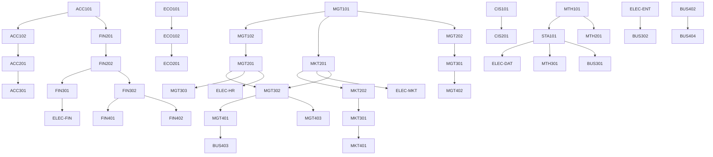

# شجرة المقررات السابقة

الرسم ده بيوضّح إيه اللي لازم تخلّصه قبل إيه. اقراه من فوق لتحت: السهم معناه "لازم الأول".

---

## الرسم الكامل



---

## السلاسل الحرجة — خد بالك منها

السلاسل دي لو وقعت فيها في مقرر، بتتأخر فصل كامل على الأقل.

### سلسلة المحاسبة والتمويل

```
ACC101 → ACC102 → ACC201 → ACC301
ACC101 → FIN201 → FIN202 → {FIN301, FIN302} → {FIN401, FIN402}
```

### سلسلة الإدارة والاستراتيجية

```
MGT101 → MGT102 → MGT201 → {MGT302, MGT303}
MGT101 → MGT202 → MGT301 → {MGT402}
MGT302 → MGT401 → BUS403
```

### سلسلة التسويق

```
MGT101 → MKT201 → MKT202 → MKT301 → MKT401
```

### سلسلة الكمية والبحث

```
MTH101 → {STA101, MTH201} → MTH301
STA101 → BUS301
```

### سلسلة مشروع التخرج

```
BUS402 → BUS404
```

---

## جدول مبسّط: كل مقرر وفصله

| الفصل | المقررات |
|---|---|
| 1 | ACC101, MGT101, ECO101, MTH101, BUS101, CIS101 |
| 2 | ACC102, MGT102, ECO102, STA101, BUS102, LAW101 |
| 3 | MKT201, FIN201, ACC201, ECO201, MTH201, ELEC-ENT |
| 4 | MGT201, MGT202, FIN202, MKT202, CIS201, ELEC-DAT |
| 5 | ACC301, MKT301, FIN301, MGT301, MTH301, ELEC-MKT |
| 6 | MGT302, FIN302, BUS301, MGT303, BUS302, ELEC-HR |
| 7 | MGT401, FIN401, MGT402, BUS401, BUS402, ELEC-PRO |
| 8 | MGT403, FIN402, MKT401, BUS403, BUS404, ELEC-FIN |

الرسم ده مطابق تمامًا لجدول المقررات في ملف `course-inventory.md`.