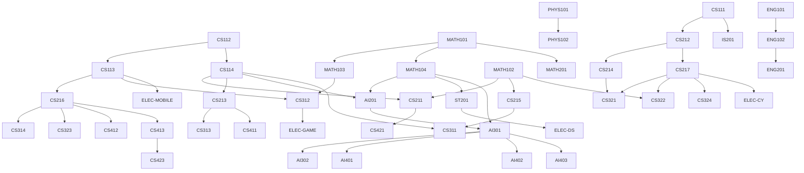

# شجرة المقررات السابقة

الرسم ده بيوضّح إيه اللي لازم تخلّصه قبل إيه. اقراه من فوق لتحت: السهم معناه "لازم الأول".

---

## الرسم الكامل



---

## السلاسل الحرجة — خد بالك منها

السلاسل دي لو وقعت فيها في مقرر، بتتأخر فصل كامل على الأقل.

### سلسلة البرمجة وهياكل البيانات

```
CS112 → CS113
CS112 → CS114 → {CS211, CS213, AI201}
CS211 → CS421
```

### سلسلة الأنظمة والشبكات

```
CS111 → CS212 → {CS214, CS217}
CS214 → CS321
CS217 → {CS322, CS324, CS321}
```

### سلسلة الذكاء الاصطناعي

```
MATH104 → AI201 → AI301 → {AI302, AI401, AI402, AI403}
```

### سلسلة هندسة البرمجيات

```
CS113 → CS216 → {CS314, CS323, CS412, CS413} → CS423
```

### سلسلة الرياضيات

```
MATH101 → {MATH102, MATH103, MATH104, MATH201}
MATH104 → ST201 → ELEC-DS
```

### سلسلة قواعد البيانات

```
CS114 → CS213 → CS411
CS213 → CS313
```

### سلسلة مشروع التخرج

```
CS413 → CS423
```

---

## جدول مبسّط: كل مقرر وفصله

| الفصل | المقررات |
|---|---|
| 1 | CS111, CS112, MATH101, MATH102, PHYS101, ENG101 |
| 2 | CS113, CS114, MATH103, MATH104, PHYS102, ENG102 |
| 3 | CS211, CS212, CS213, MATH201, IS201, ENG201 |
| 4 | CS214, CS215, CS216, CS217, AI201, ST201 |
| 5 | CS311, CS312, CS313, AI301, CS314, IS301 |
| 6 | CS321, AI302, CS322, CS323, CS324, ELEC-DS |
| 7 | AI401, AI402, CS411, CS412, CS413, ELEC-CY |
| 8 | AI403, CS421, CS422, CS423, ELEC-MOBILE, ELEC-GAME |

الرسم ده مطابق تمامًا لجدول المقررات في ملف `course-inventory.md`.